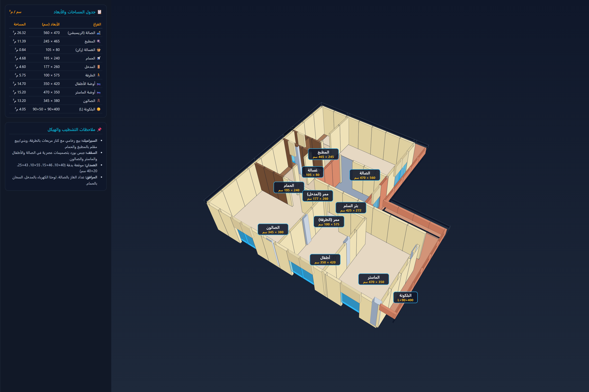
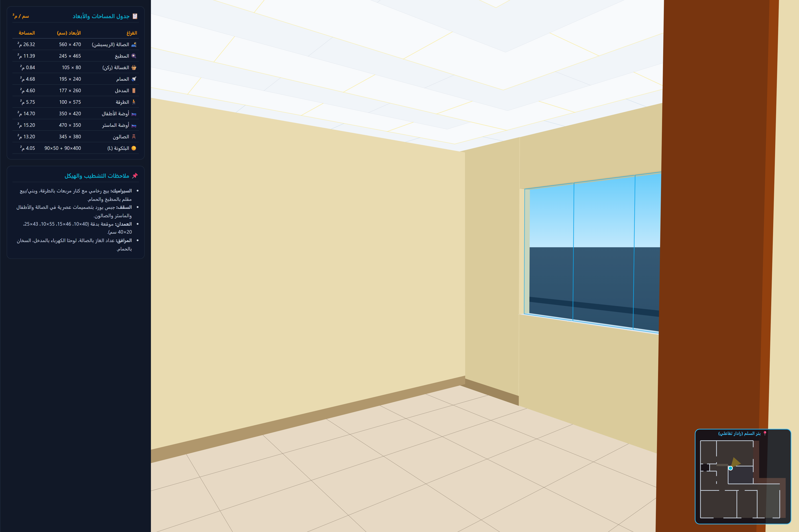

# المخطط المعماري المتكامل 2D & 3D + التجول الداخلي — شقة م. زيدان (12.50 × 8.05 م)

مشروع هندسي متكامل لتحويل الرفع المساحي الميداني (فيديو + 89 صورة بزاوية واسعة + 5 كروكيات يدوية) إلى مخططات معمارية **2D CAD** و**نموذج 3D تفاعلي** خالية من الأثاث افتراضياً، مع **تجول داخلي حر ثلاثي الأبعاد (First-Person Walkthrough)** وفيديو كامل من داخل الشقة.

> 🌐 **المعاينة التفاعلية المباشرة:** افتح [`Zedan_Apartment_2D_3D_Studio.html`](./Zedan_Apartment_2D_3D_Studio.html) أو [`index.html`](./index.html) في أي متصفح للتبديل بين وضع Blueprint، ووضع 2D الملون، والمجسم ثلاثي الأبعاد 3D، و**تبويب التجول الداخلي الحر (`🚶 تجول داخلي 3D`)** مع تحكم بـ `WASD`/الأسهم، السحب بالماوس، أزرار الشاشة، والرادار التفاعلي.

---

## 🎥 فيديو الجولة ثلاثية الأبعاد من الداخل

- ▶️ [`Zedan_Apartment_3D_Walkthrough.mp4`](./Zedan_Apartment_3D_Walkthrough.mp4) (`3.05 MB` — دقة `1280×720`، `180` إطار بمعدل `15 fps`): جولة متكاملة تبدأ من بئر السلم مروراً بباب الشقة إلى الصالة، المطبخ، الغسالة، الحمام، الصالون، غرفة الأطفال، الماستر، وحتى البلكونة المتدرجة.

---

## 📸 اللوحات المعمارية المخرجة (3600 × 2400 px)

### 1. المخطط الهندسي ثنائي الأبعاد بدون أثاث (2D CAD Blueprint)

### 2. المخطط الملون بالتشطيبات بدون أثاث (2D Luxury Colored)

### 3. المنظور ثلاثي الأبعاد بدون أثاث (3D Isometric Dollhouse)

### 4. منظور التجول الداخلي الأول (3D Walkthrough Interior)

---

## 📋 جدول المساحات والأبعاد المعتمدة

| الفراغ | الأبعاد (سم) | المساحة (م²) |
|---|---|---|
| 🛋️ **الصالة (الريسبشن)** | `560 × 470` | `26.32 م²` |
| 🍳 **المطبخ** | `465 × 245` | `11.39 م²` |
| 🧺 **ركن الغسالة + المنور** | `105 × 80` + `50 × 46` | `0.84 م²` |
| 🚿 **الحمام** | `240 × 195` | `4.68 م²` |
| 🚪 **الممر الرأسي (المدخل)** | `260 × 177` | `4.60 م²` |
| 🚶 **الممر الأفقي (الطرقة)** | `575 × 100` | `5.75 م²` |
| 🪑 **الصالون** | `380 × 345` | `13.20 م²` |
| 🛏️ **أوضة الأطفال** | `420 × 350` | `14.70 م²` |
| 🛏️ **أوضة الماستر** | `470 × 350` | `15.20 م²` |
| ☀️ **البلكونة المتدرجة (L-Shaped)** | `400 × 90 + L` | `4.05 م²` |

---

## 📂 محتويات المشروع

- `Zedan_Apartment_CAD.dxf` — ملف أوتوكاد قياسي بطبقات منفصلة (الحوائط الخارجية/الداخلية، الأعمدة الخرسانية، الأبواب، الشبابيك، المنور، بئر السلم، المقاسات).
- `Zedan_Apartment_2D_3D_Studio.html` / `index.html` — استوديو تفاعلي 2D & 3D + تجول داخلي حر يعمل بالكامل دون إنترنت.
- `generate_dxf.py` — سكريبت Python (`ezdxf`) لتوليد ملف الـ CAD بدقة السنتيمتر.
- `render_highres_sheets.js` — سكريبت Node.js (`puppeteer`) لتصدير اللوحات الهندسية والداخلية بدقة `3600×2400`.
- `render_walkthrough_video.js` و`encode_video.py` — سكريبتات رندر وتجميع فيديو الجولة الداخلية (`1280×720`, `15 fps`).
- `FloorPlan_2D_Engineering_Blueprint.png`, `FloorPlan_2D_Luxury_Colored.png`, `Apartment_3D_Isometric_Render.png`, `Apartment_3D_Walkthrough_Interior.png`, `Zedan_Apartment_3D_Walkthrough.mp4`.
